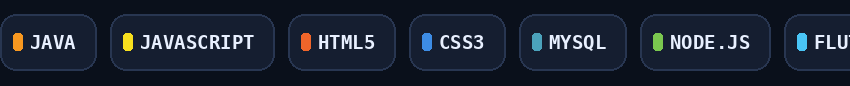
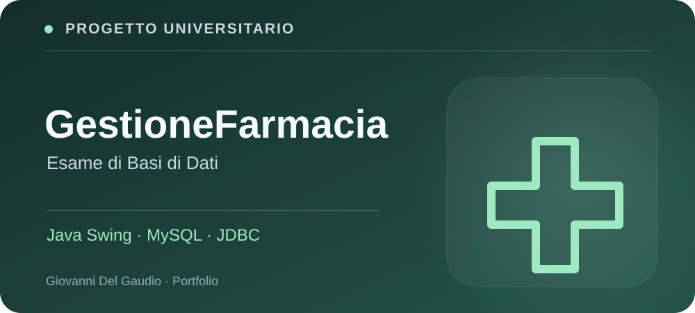
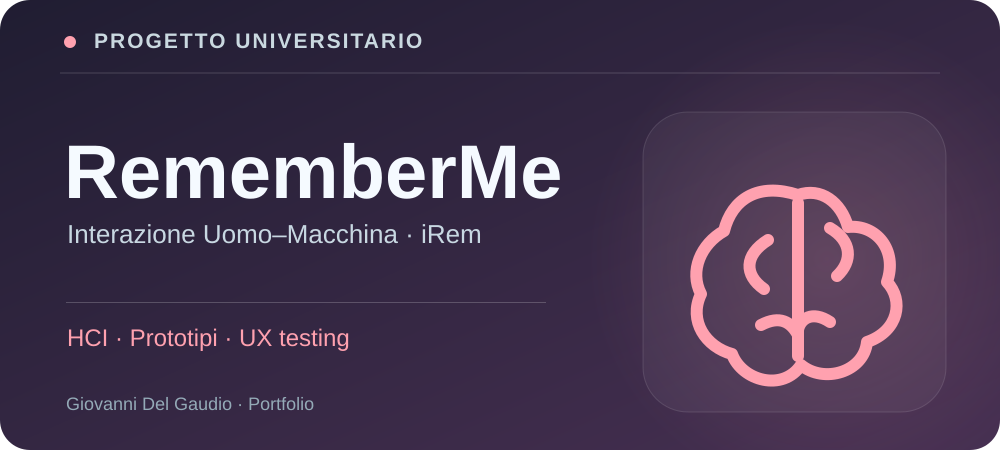

# Ciao, sono Giovanni 👋

### 💻 Aspiring Software Developer · Computer Science Student · Creative Builder

**Progetto applicazioni web e mobile e trasformo idee in prototipi concreti.**  
**I build thoughtful software, learn by shipping, and document the journey.**

---

## ✦ Chi sono

Sono uno studente di **Informatica** vicino alla conclusione del percorso universitario e sto costruendo un portfolio per iniziare a lavorare nello **sviluppo software**.

Mi appassionano applicazioni che risolvono problemi reali: dal **database** alle **API**, dall'interfaccia alle verifiche automatiche. Sto lavorando a progetti web, mobile e a prototipi che integrano l'intelligenza artificiale, con particolare attenzione a usabilità, architettura e privacy.

- 🔨 **Current focus:** FORMA AI e DriveGlass
- 📚 **Learning by building:** Flutter, Dart, API backend e test automatizzati
- 🎯 **Career goal:** prima opportunità come **Junior Software Developer**
- 🤝 **Principio di lavoro:** documentare ciò che funziona, dichiarare cosa è sperimentale, migliorare un passo alla volta

## ✦ Il mio stack

  

| Ambito | Tecnologie effettivamente usate o in apprendimento |
|:--|:--|
| **Web** | HTML, CSS, JavaScript, Bootstrap 4, Java JSP/Servlet |
| **Database e backend** | MySQL, Node.js; sviluppo con TypeScript, NestJS e PostgreSQL in progetti in corso |
| **App multipiattaforma** | Flutter, Dart e persistenza locale |
| **Software engineering** | Git, GitHub, REST API, debugging, testing e documentazione tecnica |

> Le tecnologie riportate rappresentano esperienza progettuale e formazione in corso, non certificazioni di livello senior.

## 🚀 Progetti personali

**Applicazioni e prototipi indipendenti**, sviluppati per sperimentare tecnologie e creare prodotti concreti. Apri una copertina per visualizzare la cartella con la presentazione pubblica del progetto.

| | |
|:--|:--|
|  **[FORMA AI](projects/forma-ai/)** Fitness & AI · Demo pubblica [▶ Demo live](https://giovannidelgaudio1994.github.io/forma-ai/) |  **[DriveGlass](projects/driveglass/)** Garage digitale · Flutter · In sviluppo [📂 Scheda progetto](projects/driveglass/) |
|  **[Fit Zone](projects/fit-zone/)** Gestionale palestra · PHP + MongoDB [📂 Scheda progetto](projects/fit-zone/) |  **[Cilento Platform](projects/cilento-platform/)** Turismo, territorio & backend · In sviluppo [📂 Scheda progetto](projects/cilento-platform/) |

**Altro progetto:** [Gestionale B&B](projects/gestionale-bnb/) · presentazione in preparazione.

---

## 🎓 Progetti universitari

**Analisi, progettazione, sviluppo e valutazione.** Qui trovi i progetti collegati ai corsi universitari, con relazioni, metodologie e materiali dimostrativi dove disponibili.

| | |
|:--|:--|
|  **[GestioneFarmacia](projects/gestione-farmacia/)** Basi di Dati · Java + MySQL · Codice privato [▶ Demo fedele al gestionale](https://giovannidelgaudio1994.github.io/forma-ai/gestione-farmacia-demo/) · [☕ Vedi codice Java selezionato](projects/gestione-farmacia/codice-pubblico/) |  **[e-Wine](projects/e-wine/)** Tecnologie Web e Ingegneria del Software [📂 Documentazione](projects/e-wine/) |
|  **[RememberMe · iRem](projects/rememberme/)** Interazione Uomo–Macchina · Progetto di gruppo [▶ Prototipo animato](projects/rememberme/assets/irem-prototipo-animato.svg) |   |

> **Come consultare il portfolio:** clicca sulla copertina o sul nome per aprire la **cartella pubblica** del progetto; usa i link «Demo» per vedere le simulazioni. Le schede del portfolio non implicano che esista una repository pubblica separata per ogni progetto. I codici sorgente proprietari rimangono privati.

---

## ✦ Come lavoro

`Idea` → `Requisiti` → `Modello dati` → `Sviluppo` → `Test` → `Documentazione` → `Miglioramento`

Mi interessa soprattutto dimostrare **cosa ho realizzato**, non riempire il profilo di numeri o statistiche poco significativi. Nei repository troverai descrizioni chiare, stato reale di sviluppo, istruzioni per provare i prototipi e limiti delle funzionalità.

---

**Let’s build something useful.** ✨

[Esplora i repository](https://github.com/GiovanniDelGaudio1994?tab=repositories) · [FORMA AI Demo](https://giovannidelgaudio1994.github.io/forma-ai/)

© 2026 Giovanni Del Gaudio · Profile README · All rights reserved for original artwork.

