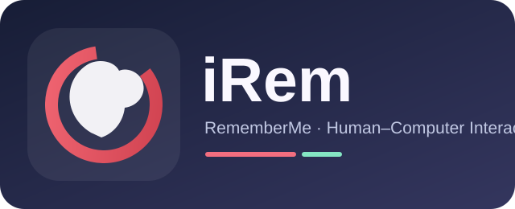

# Ciao, sono Giovanni 👋

### 💻 Aspiring Software Developer · Computer Science Student · Creative Builder

**Progetto applicazioni web e mobile e trasformo idee in prototipi concreti.**  
**I build thoughtful software, learn by shipping, and document the journey.**

---

## ✦ Chi sono

Sono uno studente di **Informatica** vicino alla conclusione del percorso universitario e sto costruendo un portfolio per iniziare a lavorare nello **sviluppo software**.

Mi appassionano applicazioni che risolvono problemi reali: dal **database** alle **API**, dall'interfaccia alle verifiche automatiche. Sto lavorando a progetti web, mobile e a prototipi che integrano l'intelligenza artificiale, con particolare attenzione a usabilità, architettura e privacy.

- 🔨 **Current focus:** FORMA AI e DriveGlass
- 📚 **Learning by building:** Flutter, Dart, API backend e test automatizzati
- 🎯 **Career goal:** prima opportunità come **Junior Software Developer**
- 🤝 **Principio di lavoro:** documentare ciò che funziona, dichiarare cosa è sperimentale, migliorare un passo alla volta

## ✦ Il mio stack

  

| Ambito | Tecnologie effettivamente usate o in apprendimento |
|:--|:--|
| **Web** | HTML, CSS, JavaScript, Bootstrap 4, Java JSP/Servlet |
| **Database e backend** | MySQL, Node.js; sviluppo con TypeScript, NestJS e PostgreSQL in progetti in corso |
| **App multipiattaforma** | Flutter, Dart e persistenza locale |
| **Software engineering** | Git, GitHub, REST API, debugging, testing e documentazione tecnica |

> Le tecnologie riportate rappresentano esperienza progettuale e formazione in corso, non certificazioni di livello senior.

## 🚀 Progetti personali

Applicazioni indipendenti e prototipi in sviluppo, con presentazioni pubbliche e codice proprietario protetto.

### 🏋️ [FORMA AI](https://github.com/GiovanniDelGaudio1994/forma-ai)
**Piattaforma fitness con funzionalità AI — Demo disponibile**

Applicazione *local-first* con anteprima interattiva di allenamenti, progressi, alimentazione e coach digitale. In progettazione un Exercise Atlas con schede tecniche e concept anatomici 3D.

`JavaScript` · `Node.js` · `PWA` · `Testing`

[**▶ Prova la demo interattiva**](https://giovannidelgaudio1994.github.io/forma-ai/) · [Repository della demo](https://github.com/GiovanniDelGaudio1994/forma-ai)

> Demo con dati fittizi. Alcune funzionalità AI sono anteprime; il codice completo resta privato.

---

### 🚘 [DriveGlass](projects/driveglass/README.md)
**Garage digitale e gestione veicoli — In sviluppo**

App per gestione di veicoli, chilometraggio, manutenzioni, scadenze e documenti. Include sperimentazioni con API e sincronizzazione cloud.

`Flutter` · `Dart` · `SQLite` · `TypeScript`

[**📂 Esplora DriveGlass**](projects/driveglass/README.md)

---

### 🏢 [Fit Zone](projects/fit-zone/README.md)
**Gestionale palestra — Progetto personale**

Software di gestione palestra sviluppato utilizzando PHP e MongoDB.

`PHP` · `MongoDB`

[**📂 Esplora Fit Zone**](projects/fit-zone/README.md)

---

### 🗺️ [Cilento Platform](projects/cilento-platform/README.md)
**Piattaforma per territorio e turismo — In sviluppo**

Prototipo dedicato a informazioni territoriali, strutture ricettive, aree camping e simulazioni di prenotazione.

`Web Development` · `Backend` · `Database`

[**📂 Esplora Cilento Platform**](projects/cilento-platform/README.md)

**Altro progetto personale:** [Gestionale B&B](projects/gestionale-bnb/README.md), in fase di revisione.

---

## 🎓 Progetti universitari

Elaborati realizzati durante il percorso di Informatica: progettazione, applicazioni e valutazione dell'usabilità.

### 💊 [GestioneFarmacia](projects/gestione-farmacia/README.md)
**Esame di Basi di Dati · A.A. 2024/2025**

Progetto che comprende modello E-R, schema relazionale, normalizzazione e applicazione Java Swing per operazioni gestionali su una farmacia, con database MySQL.

`Java` · `Swing` · `MySQL` · `JDBC` · `DAO`

[**📂 Documentazione del progetto**](projects/gestione-farmacia/README.md) · [**▶ Demo interattiva simulata**](https://giovannidelgaudio1994.github.io/forma-ai/gestione-farmacia-demo/)

> Codice sorgente privato. La demo è una ricostruzione con dati inventati, non l'eseguibile Java originale.

---

### 🍷 [e-Wine](projects/e-wine/README.md)
**Tecnologie Software per il Web · Ingegneria del Software**

Progetto universitario di sviluppo web e progettazione software con Java JSP/Servlet, interfaccia Bootstrap 4 e database MySQL.

`Java` · `JSP/Servlet` · `Bootstrap 4` · `MySQL`

[**📂 Esplora e-Wine**](projects/e-wine/README.md)

---

### 🧠 [RememberMe — iRem](projects/rememberme/README.md)
**Interazione Uomo–Macchina (IUM) · Progetto di gruppo**

Analisi dei bisogni degli utenti, personas, casi d'uso, paper sketch, mockup e valutazione di usabilità. Prototipo universitario storico di un'app per eventi e foto-ricordo.

`Human–Computer Interaction` · `User-Centered Design` · `Prototyping` · `Usability Testing`

[**▶ Guarda il prototipo animato**](projects/rememberme/assets/irem-prototipo-animato.svg) · [**📂 Leggi documentazione e progetto**](projects/rememberme/README.md)

> L'animazione è una ricostruzione dimostrativa delle schermate del prototipo PowerPoint, non una registrazione dell'app Android.

---

## ✦ Come lavoro

`Idea` → `Requisiti` → `Modello dati` → `Sviluppo` → `Test` → `Documentazione` → `Miglioramento`

Mi interessa soprattutto dimostrare **cosa ho realizzato**, non riempire il profilo di numeri o statistiche poco significativi. Nei repository troverai descrizioni chiare, stato reale di sviluppo, istruzioni per provare i prototipi e limiti delle funzionalità.

---

**Let’s build something useful.** ✨

[Esplora i repository](https://github.com/GiovanniDelGaudio1994?tab=repositories) · [FORMA AI Demo](https://giovannidelgaudio1994.github.io/forma-ai/)

© 2026 Giovanni Del Gaudio · Profile README · All rights reserved for original artwork.

