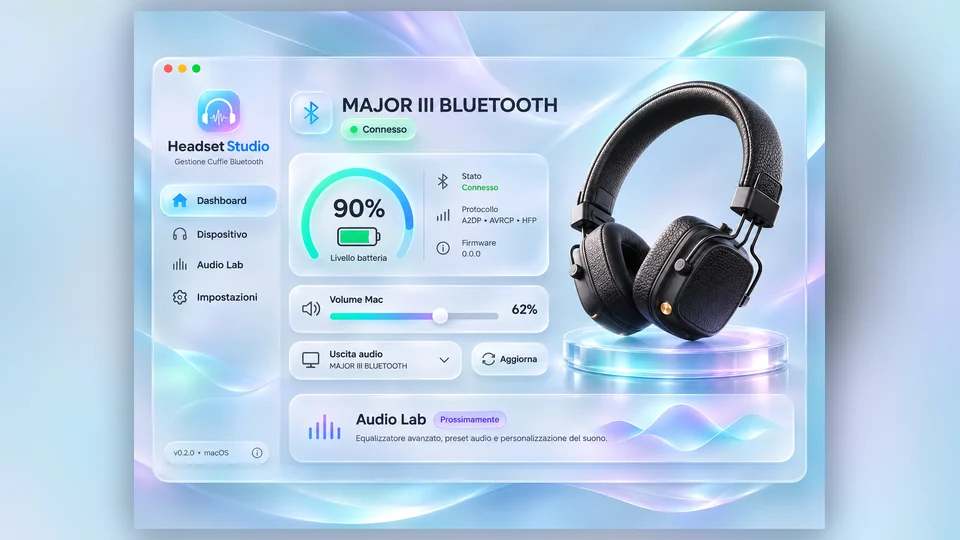
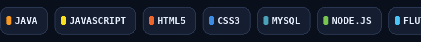

<h1>Giovanni Del Gaudio</h1>

<strong>Junior Software Developer</strong> &nbsp;·&nbsp; Studente di Informatica — Università degli Studi di Salerno

Sviluppo applicazioni desktop, mobile e web. Mi interessa costruire progetti concreti, con interfacce curate, codice mantenibile e risultati dimostrabili.

<a href="https://www.giovannidelgaudio.it/"><strong>Portfolio</strong></a> &nbsp;·&nbsp;
<a href="https://www.giovannidelgaudio.it/cv/">Curriculum</a> &nbsp;·&nbsp;
<a href="https://www.linkedin.com/in/giovanni-del-gaudio-9b6780153/">LinkedIn</a> &nbsp;·&nbsp;
<a href="https://github.com/GiovanniDelGaudio1994/giovanni-portfolio">Sorgenti del sito</a>

<a href="https://www.giovannidelgaudio.it/en/">English portfolio</a> &nbsp;·&nbsp; <a href="projects/README.md">Indice di tutti i progetti</a>

---

## Progetti in evidenza

Quattro progetti personali che rappresentano i principali ambiti su cui sto lavorando. Ogni scheda distingue chiaramente **funzionalità testate**, **demo** e **sviluppi futuri**.

<table>
<tr>
<td width="50%" valign="top">
  
  <h3><a href="projects/driveglass/">DriveGlass</a></h3>
  
FLUTTER · DART · SQLITE · DESKTOP

  
<strong>Garage digitale e manutenzione veicoli.</strong> Gestione locale di auto, interventi e documenti, con esportazione del passaporto digitale PDF.

  
<strong>Evidenza:</strong> registrazione reale dell’app macOS. Cloud e telemetria sono ancora in sviluppo; codice applicativo privato.

  
<a href="https://www.giovannidelgaudio.it/driveglass-demo/">▶ Video e demo</a> &nbsp;·&nbsp; <a href="projects/driveglass/CASE_STUDY.md">Caso studio</a>

</td>
<td width="50%" valign="top">
  
  <h3><a href="projects/forma-ai/">FORMA AI</a></h3>
  
FITNESS · PWA · JAVASCRIPT · 3D

  
<strong>Fitness intelligence e monitoraggio allenamenti.</strong> Demo Neon Edition navigabile con Exercise Atlas e modelli anatomici illustrativi.

  
<strong>Evidenza:</strong> prototipo web visitabile. Coaching AI avanzato e analisi video sono funzioni future; codice applicativo privato.

  
<a href="https://www.giovannidelgaudio.it/forma-ai-demo/">▶ Demo</a> &nbsp;·&nbsp; <a href="https://www.giovannidelgaudio.it/atlante-3d.html">Atlante 3D</a>

</td>
</tr>
<tr>
<td width="50%" valign="top">
  
  <h3><a href="projects/headset-studio/">Headset Studio</a></h3>
  
FLUTTER · DART · MACOS · BLUETOOTH

  
<strong>Companion desktop per cuffie Bluetooth.</strong> Testato su Mac con Marshall Major III, con rilevamento dispositivo e controllo del volume.

  
<strong>Evidenza:</strong> due video dell’app reale. Il mockup Liquid Glass è il <em>prossimo restyling</em>, non una funzione già implementata.

  
<a href="https://www.giovannidelgaudio.it/headset-studio-demo/">▶ Video + mockup</a> &nbsp;·&nbsp; <a href="projects/headset-studio/RESTYLING_PLAN.md">Roadmap</a>

</td>
<td width="50%" valign="top">
  
  <h3><a href="projects/legacybridge/">LegacyBridge</a></h3>
  
C++ · POWERSHELL · LINUX · HARDWARE

  
<strong>Ricerca sulla compatibilità dei computer legacy.</strong> Primo caso documentato: HP 550 con Core 2 Duo, diagnostica non invasiva e analisi delle capacità CPU.

  
<strong>Evidenza:</strong> caso studio e sonda PowerShell storica AGPLv3. I nuovi moduli restano in sviluppo proprietario.

  
<a href="https://www.giovannidelgaudio.it/legacybridge-demo/">▶ Laboratorio</a> &nbsp;·&nbsp; <a href="projects/legacybridge/README.en.md">English brief</a>

</td>
</tr>
</table>

## Web, strumenti e sperimentazione

Progetti con obiettivi più circoscritti. Le **demo** mostrano l’interfaccia o il comportamento pubblico; i collegamenti al **codice** sono indicati soltanto quando i sorgenti sono disponibili.

<table>
<tr>
<td width="50%" valign="top">
  <h3><a href="projects/fit-zone/">Fit Zone</a></h3>
  
PHP · MYSQL · GESTIONALE WEB

  
Gestione di corsi, prenotazioni e abbonamenti per una palestra. Demo pubblica con dati di esempio; backend riservato.

  
<a href="https://www.giovannidelgaudio.it/fit-zone-demo/">▶ Demo</a> &nbsp;·&nbsp; <a href="projects/fit-zone/">Scheda</a>

</td>
<td width="50%" valign="top">
  <h3><a href="https://github.com/GiovanniDelGaudio1994/forma-ai/tree/main/projects/scraper/">SignalScope</a></h3>
  
PYTHON · SQLITE · MONITORAGGIO WEB

  
Osserva fonti pubbliche, conserva snapshot e rende leggibili le modifiche. Motore CLI pubblico, con demo illustrativa.

  
<a href="https://www.giovannidelgaudio.it/signalscope-demo/">▶ Demo</a> &nbsp;·&nbsp; <a href="https://github.com/GiovanniDelGaudio1994/forma-ai/tree/main/projects/scraper/source/">Codice AGPLv3</a>

</td>
</tr>
<tr>
<td width="50%" valign="top">
  <h3><a href="https://github.com/GiovanniDelGaudio1994/forma-ai/tree/main/projects/meteo-bash2d/">Meteo Bash 2D</a></h3>
  
BASH · TERMINALE · OPEN-METEO

  
Previsioni meteo e dati reali presentati con un’interfaccia ispirata al terminale. Script Bash pubblico.

  
<a href="https://www.giovannidelgaudio.it/meteo-bash2d-demo/">▶ Demo</a> &nbsp;·&nbsp; <a href="https://github.com/GiovanniDelGaudio1994/forma-ai/tree/main/projects/meteo-bash2d/">Codice AGPLv3</a>

</td>
<td width="50%" valign="top">
  <h3><a href="projects/cilento-platform/">Cilento Platform</a></h3>
  
WEB · TURISMO · PROGETTAZIONE

  
Idea di piattaforma digitale per la valorizzazione del territorio e dei servizi turistici del Cilento.

  
<a href="projects/cilento-platform/">Scheda e obiettivi</a> &nbsp;·&nbsp; <em>In sviluppo</em>

</td>
</tr>
</table>

## Progetti universitari

Lavori sviluppati durante il percorso di Informatica presso l’Università degli Studi di Salerno: progettazione, dati e interazione uomo–macchina.

<table>
<tr>
<td width="33%" valign="top">
  <h3><a href="projects/gestione-farmacia/">GestioneFarmacia</a></h3>
  
JAVA SWING · MYSQL · JDBC

  
Gestionale con inventario, farmaci e clienti. Schema relazionale e caso studio.

  
<a href="https://www.giovannidelgaudio.it/gestione-farmacia-demo/">▶ Demo</a> <a href="projects/gestione-farmacia/CASE_STUDY.md">Caso studio</a>

</td>
<td width="33%" valign="top">
  <h3><a href="projects/e-wine/">e-Wine</a></h3>
  
JAVA · JSP · SERVLET · MYSQL

  
Progetto universitario e-commerce web; demo navigabile e sorgenti completi riservati.

  
<a href="https://www.giovannidelgaudio.it/ewine-demo/">▶ Demo</a> <a href="projects/e-wine/">Scheda tecnica</a>

</td>
<td width="33%" valign="top">
  <h3><a href="projects/rememberme/">RememberMe / iRem</a></h3>
  
UX · PROTOTIPAZIONE · IUM

  
Studio dell’interazione e prototipo navigabile per la gestione dei promemoria.

  
<a href="projects/rememberme/assets/irem-prototipo-animato.svg">▶ Prototipo</a> <a href="projects/rememberme/">Scheda progetto</a>

</td>
</tr>
</table>

<strong>Altri progetti e approfondimenti</strong>

- [Gestionale B&amp;B](projects/gestionale-bnb/) — scheda progettuale in preparazione.
- [LegacyBridge / HP 550](projects/legacybridge/) — architettura x64 confermata, Windows 10 x86 osservato e prove Linux Live pianificate.
- [Indice completo dei progetti](projects/README.md) — distingue repository pubblici, applicazioni private e demo.

---

## Competenze e metodo

| Ambito | Tecnologie e strumenti |
| :--- | :--- |
| **Desktop e mobile** | Flutter, Dart, Java |
| **Web e interfacce** | HTML, CSS, JavaScript, PHP |
| **Backend e dati** | Python, Node.js, SQL, MySQL, SQLite |
| **Sviluppo software** | Git, API REST, debug, test, UML, documentazione |

Mi interessa mostrare non soltanto il risultato grafico, ma anche **come un progetto viene analizzato, implementato e verificato**. Le competenze indicate derivano da studi e progetti con livelli di esperienza differenti.

Visualizza l’animazione dello stack tecnologico

## Informazioni su demo, codice e licenze

Le demo pubbliche possono essere prototipi, registrazioni video o interfacce statiche e **non implicano che backend privati o funzioni future siano disponibili nel browser**.

I sorgenti di **DriveGlass**, **FORMA AI** e degli altri moduli proprietari restano privati. **SignalScope**, **Meteo Bash 2D** e la sonda storica di **LegacyBridge** sono pubblicati con licenza GNU AGPL-3.0-only; la licenza non si applica automaticamente a tutto il portfolio. Dettagli nell’[indice dei progetti](projects/README.md) e nella [politica di licenza](https://github.com/GiovanniDelGaudio1994/forma-ai#politica-delle-licenze-dei-progetti-pubblici).

---

**Vuoi vedere i progetti in azione?** &nbsp; [Portfolio completo](https://www.giovannidelgaudio.it/) &nbsp;·&nbsp; [LinkedIn](https://www.linkedin.com/in/giovanni-del-gaudio-9b6780153/)

© 2026 Giovanni Del Gaudio · Materiali originali e componenti di terze parti attribuiti nei rispettivi progetti.

