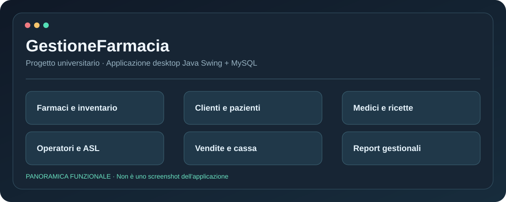

# Ciao, sono Giovanni 👋

### 💻 Aspiring Software Developer · Computer Science Student · Creative Builder

**Progetto applicazioni web e mobile e trasformo idee in prototipi concreti.**  
**I build thoughtful software, learn by shipping, and document the journey.**

---

## ✦ Chi sono

Sono uno studente di **Informatica** vicino alla conclusione del percorso universitario e sto costruendo un portfolio per iniziare a lavorare nello **sviluppo software**.

Mi appassionano applicazioni che risolvono problemi reali: dal **database** alle **API**, dall'interfaccia alle verifiche automatiche. Sto lavorando a progetti web, mobile e a prototipi che integrano l'intelligenza artificiale, con particolare attenzione a usabilità, architettura e privacy.

- 🔨 **Current focus:** FORMA AI e DriveGlass
- 📚 **Learning by building:** Flutter, Dart, API backend e test automatizzati
- 🎯 **Career goal:** prima opportunità come **Junior Software Developer**
- 🤝 **Principio di lavoro:** documentare ciò che funziona, dichiarare cosa è sperimentale, migliorare un passo alla volta

## ✦ Il mio stack

  

| Ambito | Tecnologie effettivamente usate o in apprendimento |
|:--|:--|
| **Web** | HTML, CSS, JavaScript, Bootstrap 4, Java JSP/Servlet |
| **Database e backend** | MySQL, Node.js; sviluppo con TypeScript, NestJS e PostgreSQL in progetti in corso |
| **App multipiattaforma** | Flutter, Dart e persistenza locale |
| **Software engineering** | Git, GitHub, REST API, debugging, testing e documentazione tecnica |

> Le tecnologie riportate rappresentano esperienza progettuale e formazione in corso, non certificazioni di livello senior.

## ✦ 🚀 Progetti personali

Applicazioni e prototipi sviluppati al di fuori dei corsi universitari. Alcuni sono ancora in fase di sviluppo.

<table>
  <tr>
    <td width="50%" valign="top">
      <h3>🏋️ FORMA AI</h3>
      
<strong>AI-Powered Fitness Experience</strong>

      
Piattaforma fitness <em>local-first</em> con anteprima interattiva di allenamenti, progressi, alimentazione e coach digitale. In sviluppo un Exercise Atlas con schede tecniche e concept anatomici 3D.

      
<code>JavaScript</code> <code>Node.js</code> <code>PWA</code> <code>Testing</code>

      
<a href="https://github.com/GiovanniDelGaudio1994/forma-ai">Repository demo</a> · <a href="https://giovannidelgaudio1994.github.io/forma-ai/">Prova la demo live</a>

      
⚠️ Demo con dati fittizi; le funzionalità AI avanzate sono anteprime. Il codice completo resta privato.

    </td>
    <td width="50%" valign="top">
      <h3>🚘 DriveGlass</h3>
      
<strong>Digital Garage & Vehicle Companion</strong>

      
Applicazione in sviluppo per veicoli, manutenzioni, scadenze e documenti, con sperimentazione di API e sincronizzazione cloud.

      
<code>Flutter</code> <code>Dart</code> <code>SQLite</code> <code>TypeScript</code>

      
🚧 Work in progress — codice non ancora pubblicato

    </td>
  </tr>
  <tr>
    <td width="50%" valign="top">
      <h3>🏢 Fit Zone</h3>
      
<strong>Progetto personale · Gestionale palestra</strong>

      
Progetto personale per la gestione di una palestra, sviluppato con PHP e MongoDB.

      
<code>PHP</code> <code>MongoDB</code>

      
🔧 In revisione per una presentazione pubblica del progetto

    </td>
    <td width="50%" valign="top">
      <h3>🗺️ Cilento Platform</h3>
      
<strong>Territory & Tourism Platform</strong>

      
Prototipo digitale per il Cilento: informazioni territoriali, strutture ricettive, camping e simulazioni di prenotazione.

      
<code>Web Development</code> <code>Backend</code> <code>Database</code>

      
🚧 Work in progress — funzionalità non ancora complete

    </td>
  </tr>
</table>

**Altro progetto personale:** **Gestionale B&B** — da revisionare e documentare per il portfolio.

## ✦ 🎓 Progetti universitari

Progetti sviluppati nell'ambito di insegnamenti universitari, con attenzione a requisiti, progettazione, database e documentazione tecnica.

<table>
  <tr>
    <td width="50%" valign="top">
      <h3>💊 GestioneFarmacia</h3>
      
<strong>Basi di Dati · A.A. 2024/2025</strong>

      
Progettazione E-R, schema relazionale, normalizzazione e applicazione desktop per la gestione farmaceutica, con interfaccia grafica e interrogazioni al database.

      
<code>Java</code> <code>Swing</code> <code>MySQL</code> <code>JDBC</code> <code>DAO</code>

      
🔒 Codice privato · Descrizione pubblica disponibile più sotto

    </td>
    <td width="50%" valign="top">
      <h3>🍷 e-Wine</h3>
      
<strong>Tecnologie Software per il Web · Ingegneria del Software</strong>

      
Progetto universitario di sviluppo web e attività di progettazione software, con interfaccia realizzata in JSP/Servlet, Bootstrap 4 e MySQL.

      
<code>Java</code> <code>JSP/Servlet</code> <code>MySQL</code> <code>Bootstrap 4</code>

      
📚 Codice e documentazione in revisione prima della pubblicazione

    </td>
  </tr>
  <tr>
    <td width="50%" valign="top">
      <h3>🧠 RememberMe</h3>
      
<strong>Interazione Uomo-Macchina (IUM)</strong>

      
Progetto universitario da presentare con la relativa documentazione e il materiale applicativo.

      
📄 Analisi tecnica e screenshot da aggiungere dopo la revisione dei materiali

    </td>
    <td width="50%" valign="top">
      <h3>📘 Formazione universitaria</h3>
      
<strong>Analisi · Progettazione · Sviluppo · Documentazione</strong>

      
I progetti accademici mostrano il percorso dalla raccolta dei requisiti alle scelte progettuali e all'implementazione.

      
🎓 Portfolio di uno studente di Informatica

    </td>
  </tr>
</table>

## ✦ Progetto universitario: GestioneFarmacia

  

**GestioneFarmacia** è un progetto universitario di applicazione desktop progettata per rappresentare le principali attività gestionali di una farmacia. Ho sviluppato interfacce in **Java Swing** e l'accesso ai dati su **MySQL** tramite **JDBC** e classi **DAO (Data Access Object)**.

Il codice contiene moduli per **anagrafiche di clienti, pazienti, medici e operatori**, **farmaci e inventario**, **ricette**, **vendite e cassa**, **ASL** e **report gestionali**. La struttura distingue le classi di dominio (`model`), l'accesso ai dati (`dao`) e l'interfaccia grafica (`gui`).

`Java` · `Swing` · `MySQL` · `JDBC` · `DAO` · `Eclipse`

> 🔒 **Codice sorgente privato — © 2026 Giovanni Del Gaudio. Tutti i diritti riservati.** La grafica qui sopra è una **panoramica illustrativa**, non uno screenshot dell'app avviata. Progetto accademico dimostrativo; non destinato a un utilizzo sanitario o commerciale reale.

## ✦ Come lavoro

`Idea` → `Requisiti` → `Modello dati` → `Sviluppo` → `Test` → `Documentazione` → `Miglioramento`

Mi interessa soprattutto dimostrare **cosa ho realizzato**, non riempire il profilo di numeri o statistiche poco significativi. Nei repository troverai descrizioni chiare, stato reale di sviluppo, istruzioni per provare i prototipi e limiti delle funzionalità.

---

**Let’s build something useful.** ✨

[Esplora i repository](https://github.com/GiovanniDelGaudio1994?tab=repositories) · [FORMA AI Demo](https://giovannidelgaudio1994.github.io/forma-ai/)

© 2026 Giovanni Del Gaudio · Profile README · All rights reserved for original artwork.

