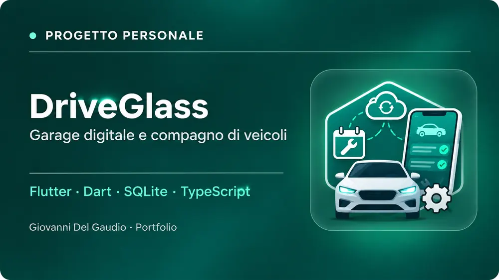

# DriveGlass

Progetto personale in sviluppo per la gestione di veicoli, manutenzioni, scadenze e documenti. Stack: Flutter, Dart, SQLite; componenti cloud e TypeScript in sperimentazione. Il codice non è pubblico.

© 2026 Giovanni Del Gaudio. Tutti i diritti riservati sui contributi originali.
