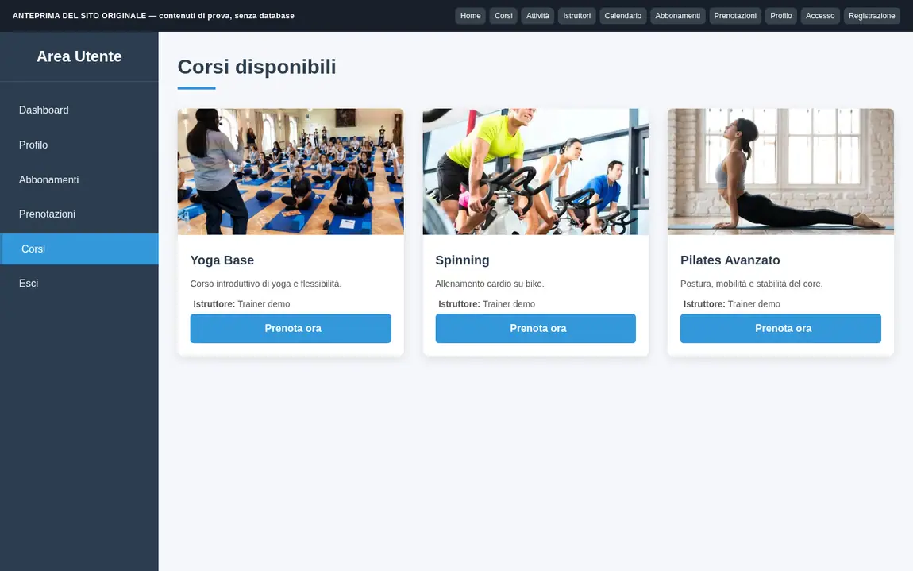
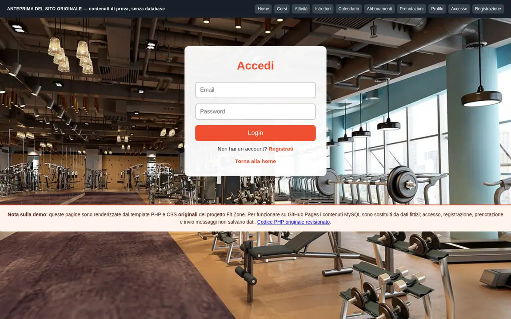
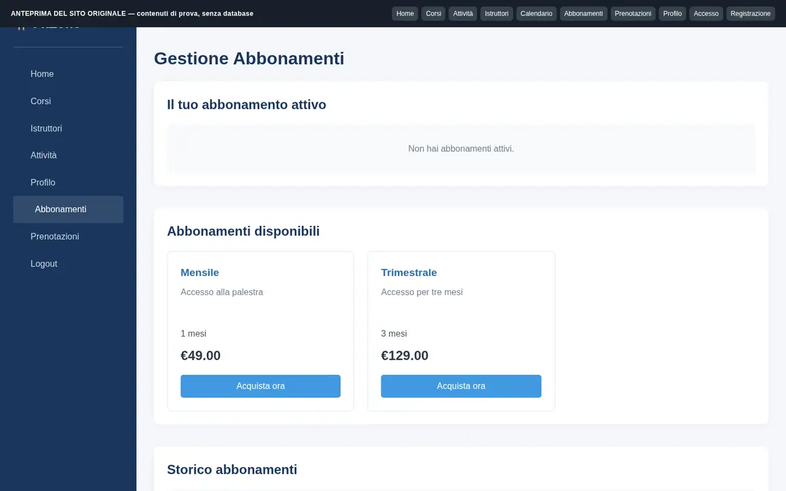
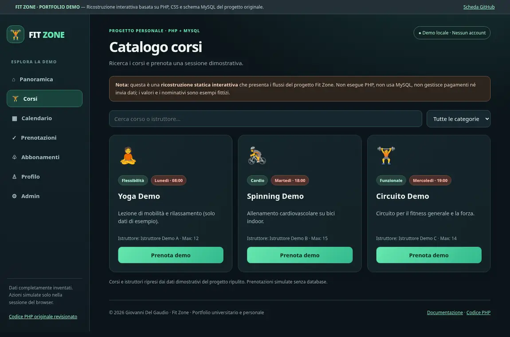
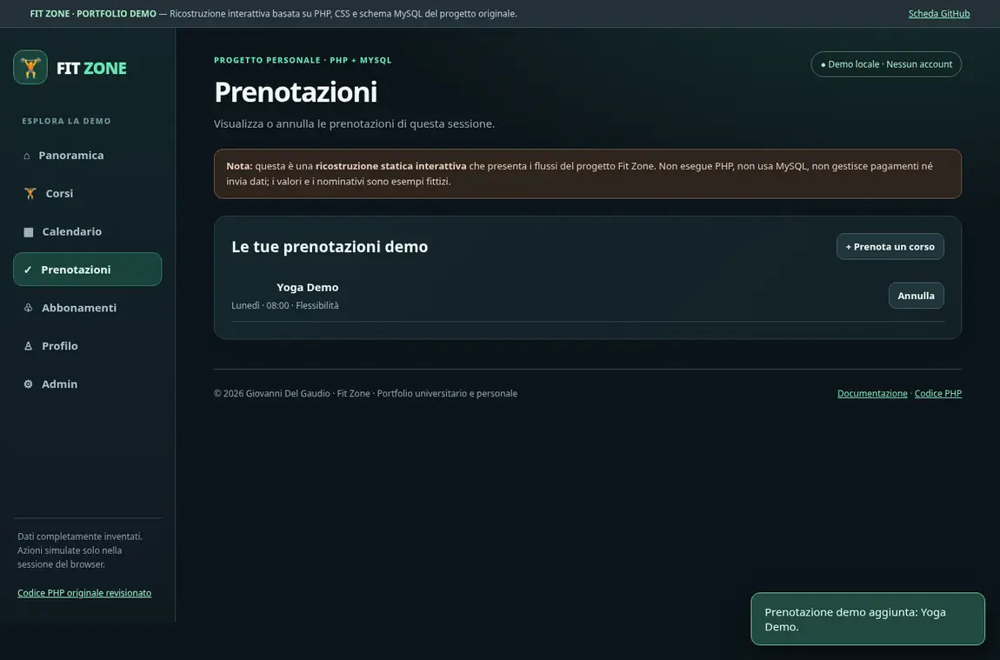
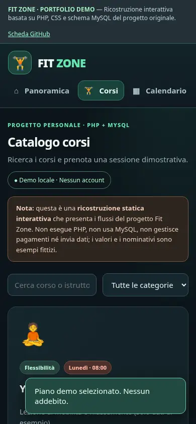

# 🏋️ Fit Zone — Gestionale web per palestra

**Progetto personale · PHP + MySQL · Pubblicazione del codice per portfolio**

Fit Zone è una web app sviluppata come progetto personale, dedicata alla gestione di una palestra: presentazione di corsi e istruttori, prenotazioni, abbonamenti, account e area amministratore. Questa versione conserva l'architettura e le pagine del progetto originale, accompagnate da una prima revisione di sicurezza.

## 🖥️ Il vero sito Fit Zone — dalle pagine originali

**[▶ Apri l'anteprima del sito originale](https://giovannidelgaudio1994.github.io/forma-ai/fit-zone-demo/)** · [☕ Consulta il vero codice PHP/MySQL](source/)

Questa presentazione mostra **l'interfaccia realmente progettata e scritta per Fit Zone**, ricavata dai file originali `index.php`, `corsi.php`, `login.php`, `register.php` e dalle altre pagine del progetto. Sono mantenuti **fotografie, impaginazione, colori arancioni, tipografia e fogli CSS originali**. Non si tratta più del dashboard scuro ricostruito in precedenza.

> **Limite tecnico:** GitHub Pages visualizza HTML/CSS/JavaScript, ma non esegue PHP e MySQL. Le schermate sono prodotte dai template PHP originali con **dati dimostrativi**, senza account o contatti reali. Accesso, registrazione, prenotazione e pagamenti non salvano informazioni. Non è una versione PHP/MySQL in produzione.

| Homepage originale | Catalogo corsi originale |
|---|---|
|  |  |

| Accesso originale | Abbonamenti originali |
|---|---|
|  |  |

Nell'anteprima puoi sfogliare **homepage, corsi, attività, istruttori, calendario, abbonamenti, prenotazioni, profilo, login e registrazione**. Il backend autentico da evolvere si trova nella cartella [`source/`](source/).

**Nota sulle fotografie:** provengono dallo ZIP originale condiviso dall'autore e sono state compresse per il web. Le rispettive licenze e attribuzioni andranno verificate prima di una pubblicazione commerciale.

 

> **Demo di portfolio:** ricostruzione HTML/CSS/JavaScript dell'interfaccia e dei flussi presenti nel codice PHP, con dati sintetici. Non esegue PHP, non accede al database e non gestisce pagamenti o registrazioni reali.

## Anteprima dell'interfaccia

| Panoramica demo | Catalogo corsi |
|:--:|:--:|
|  |  |
| Prenotazioni simulate | Layout smartphone |
|  |  |

Le anteprime sopra derivano dalla **demo web ricostruita e testata**, non sono schermate catturate da un server PHP/MySQL in esecuzione. Le funzioni rappresentate riflettono le sezioni del progetto originale; i numeri, i nomi e le prenotazioni sono dimostrativi.

## Esplora il progetto

- **[📂 Sfoglia il codice sorgente PHP](source/)** — codice reale del progetto, ripulito prima della pubblicazione.
- **[📖 Leggi la documentazione tecnica completa](source/README.md)** — funzionalità, file, architettura e installazione locale.
- **[🗺️ Roadmap e futuri branch](source/ROADMAP.md)** — sicurezza, prenotazioni e miglioramenti UI.
- **[🔎 Audit della pubblicazione](source/AUDIT-PUBBLICAZIONE.md)** — interventi effettuati e problemi ancora da risolvere.

## Funzionalità e architettura

| Area | Descrizione |
|---|---|
| **Sito palestra** | Homepage, presentazione dei servizi, galleria, orari e FAQ |
| **Account** | Registrazione, login, logout e gestione del profilo |
| **Corsi** | Catalogo, categorie, dettagli, istruttori e calendario |
| **Prenotazioni** | Prenotazione delle sessioni, disponibilità e cancellazione |
| **Abbonamenti** | Piani e storico abbonamenti |
| **Amministrazione** | Utenti, corsi e istruttori |
| **Database** | Schema relazionale MySQL, connessioni tramite `mysqli` |

**Stack accertato dall'analisi del codice:** `PHP` · `MySQL` · `HTML` · `CSS` · `JavaScript` · `mysqli`.

## Come usare il codice

La cartella `source/` contiene PHP, fogli CSS, JavaScript, configurazione MySQL da variabili d'ambiente e uno schema SQL con **dati di esempio inventati**. Le credenziali originali e i record di utenti e contatti non sono stati pubblicati. Le immagini fotografiche originali sono state sostituite con un segnaposto finché non sarà verificata la licenza d'uso.

**Non è ancora una release pronta per un hosting Internet.** Sono stati verificati i file con il linter PHP, ma non l'intero flusso con MySQL. Restano da completare CSRF, autorizzazioni, verifica delle prenotazioni, test e rifiniture UI.

## Repository e branch

Per ora il codice è consultabile **nella repository pubblica del portfolio**, all'interno della cartella `projects/fit-zone/source/`. La repository indipendente `Fit-Zone` non è stata ancora creata. Quando sarà disponibile, la storia di sviluppo si potrà organizzare in branch tematici e pull request.

© 2026 Giovanni Del Gaudio sui contributi originali. La visibilità pubblica non comporta automaticamente una licenza open source.
