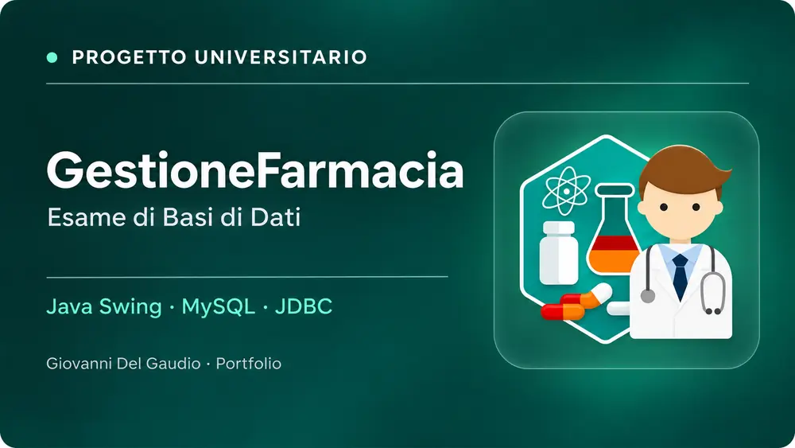

[](./)

# 💊 GestioneFarmacia — Progetto di Basi di Dati

**Università degli Studi di Salerno · A.A. 2024/2025 · Progetto universitario Java Swing + MySQL**

Gestionale desktop sviluppato per l'esame di **Basi di Dati**. Il lavoro comprende analisi dei requisiti, modello Entity–Relationship, analisi delle operazioni e dei volumi, traduzione nello schema relazionale, normalizzazione e implementazione di un'interfaccia Java Swing collegata a MySQL.

[Leggi il caso studio tecnico: modello dati e architettura](CASE_STUDY.md)

## 🖥️ Demo interattiva ispirata alle schermate originali

[**▶ APRI LA DEMO VISUALE DI GESTIONEFARMACIA**](https://www.giovannidelgaudio.it/gestione-farmacia-demo/)

La nuova demo riproduce l'organizzazione del vero gestionale desktop documentato nelle schermate: **login “Login Database”**, barra blu con titolo *Sistema di Gestione Farmaceutica*, menu laterale dei moduli, **farmaci da banco e prescritti**, **gestione pazienti**, **operatori e vendita**, **ricette**, **clienti**, **medici**, **ASL** e **report**.

La demo è **un'implementazione web ricostruttiva**, non il programma Java originale: utilizza dati sintetici locali, funziona senza installare MySQL e alcune operazioni di scrittura sono rappresentate come anteprime. Il codice completo del gestionale rimane privato.

## Funzionalità del progetto originale

| Modulo | Responsabilità |
|---|---|
| **Farmaci** | Gestione inventario, quantità, prezzi e distinzione OTC / ETICI |
| **Pazienti** | Anagrafiche, consultazione e interrogazioni |
| **Clienti** | Gestione dei clienti |
| **Operatori** | Anagrafica degli operatori, assegnazione alle casse, vendite |
| **Ricette** | Prescrizioni con riferimenti a medico, paziente e farmaco |
| **Medici** | Anagrafiche e interrogazioni |
| **ASL** | Informazioni e accrediti |
| **Report** | Inventario, vendite e dati di supporto gestionale |

Queste aree sono riscontrabili nell'interfaccia e nelle classi del progetto Java.

## Architettura

```text
GestioneFarmacia/
├── src/
│   ├── model/    # Entità e strutture dati
│   ├── dao/      # Persistenza JDBC e query SQL
│   └── gui/      # Finestre Java Swing
├── resources/    # Risorse grafiche
└── farmacia.sql  # Schema e dataset (privati)
```

Il livello **model** rappresenta le entità del dominio; il livello **dao** concentra le operazioni su database tramite JDBC, mentre il package **gui** contiene le schermate applicative. Il progetto originale ha configurazioni storiche e richiede un ambiente MySQL locale per essere eseguito integralmente.

## 👨‍💻 Una parte del codice Java originale è pubblica

Per consentire ai recruiter tecnici di valutare una parte del lavoro senza rendere pubblico tutto il programma, ho selezionato due classi reali del progetto dal package `model`:

- [**Farmaco.java**](codice-pubblico/Farmaco.java) — modello di farmaco, proprietà e riferimenti alle ricette.
- [**ReportInventario.java**](codice-pubblico/ReportInventario.java) — struttura dati per i report dell'inventario.
- [**Leggi le note sul codice pubblicato**](codice-pubblico/README.md).

Sono versioni di lettura leggermente riformattate. I DAO, le password, gli account MySQL, il file SQL e il resto del sorgente **non** vengono distribuiti.

## Screenshot autentici e tutela dei dati

La documentazione dell'esame mostra le schermate della versione originale (login, navigazione farmaci, gestione pazienti, operatori e ricette). Alcune immagini originali riportano **nomi, contatti e codici fiscali**: per evitare divulgazioni indesiderate non vengono ripubblicate tali e quali. La demo permette di esaminare gli stessi moduli con **dati fittizi**.

## Competenze messe in evidenza

`Java` · `Swing` · `MySQL` · `SQL` · `JDBC` · `DAO` · `E-R` · `Progettazione logica` · `Normalizzazione 3NF`

> **Progetto accademico**: non è un prodotto sanitario in esercizio e non è destinato alla gestione di pazienti reali.

---

**Copyright © 2026 Giovanni Del Gaudio. Tutti i diritti riservati sui contributi originali.** La pubblicazione di un estratto del codice è destinata alla lettura tecnica e non concede una licenza open source.


## Licenza e diritti del progetto

**Estratti Java e demo:** diritti riservati sui contributi originali pubblicati per valutazione; non è stata concessa una licenza AGPLv3. Materiali di terzi restano ai rispettivi titolari.

Le licenze open source non proibiscono la copia delle idee; verifica sempre il testo della licenza del singolo componente.
